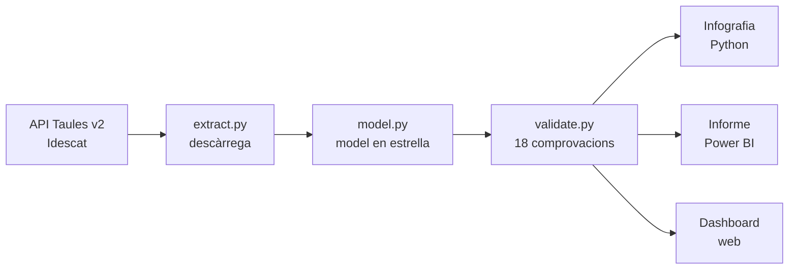
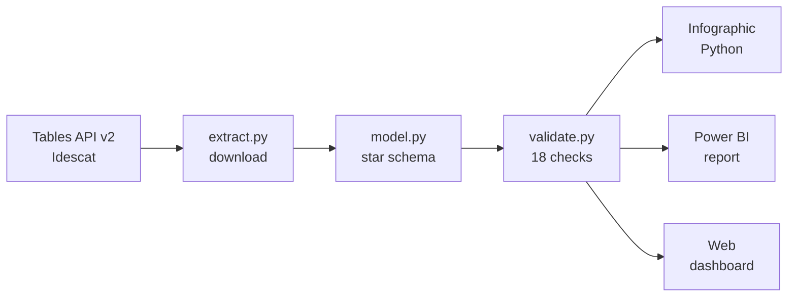

# Informe econòmic de Catalunya · dades de l'Idescat

[](https://github.com/uriferret/idescat-economic-report/actions/workflows/proves.yml)
[](https://github.com/uriferret/idescat-economic-report/releases)
[](LICENSE)


[](https://www.idescat.cat)

*[English below](#english)*

On es genera la riquesa a Catalunya, on viu la gent i com hi viu. Aquest informe compara les **42 comarques i l'Aran** i els **8 àmbits territorials** amb dades oficials de l'[Idescat](https://www.idescat.cat).

![Infografia de l'informe econòmic de Catalunya. El PIB ha crescut un 42% entre el 2011 i el 2023 (un 19% en termes reals) i l'àmbit Metropolità en genera el 68%. El Penedès és l'àmbit que més ha crescut en població des del 1981 (+120%). Un gràfic de bombolles compara el PIB per habitant i la renda per persona de cada comarca: la Ribera d'Ebre té el PIB per habitant més alt però una renda per sota de la mitjana, i el Garraf, el contrari. L'IST només supera la mitjana catalana a l'àmbit Metropolità, i el PIB per habitant no hi té relació.](python/output/informe_economic_catalunya.png)

## Què hi trobaràs

| Versió | Per a què | Com obrir-la |
|---|---|---|
| [**Infografia**](python/) | Llegir les conclusions en una sola pàgina | Obre la imatge [PNG](python/output/informe_economic_catalunya.png) o el [PDF](python/output/informe_economic_catalunya.pdf) |
| [**Informe de Power BI**](powerbi/) | Explorar les dades per any, àmbit i comarca | Obre `powerbi/informe_economic.pbip` amb Power BI Desktop. Les instruccions són a [`powerbi/README.md`](powerbi/) |
| [**Dashboard web**](https://claude.ai/artifact/F5mz53ZLQtgQfxVQYd6nZW) | Consultar l'informe des del navegador, sense instal·lar res | Accés restringit: [sol·licita'n l'accés](https://www.linkedin.com/in/oriol-ferret) i obre [l'enllaç](https://claude.ai/artifact/F5mz53ZLQtgQfxVQYd6nZW) |

### L'informe de Power BI


Té tres pàgines (*Resum*, *Comarques* i *Laboral*) i es pot filtrar per any, àmbit i comarca. Les captures de totes les pàgines són a [`powerbi/captures/`](powerbi/captures/).

## Principals conclusions

- **El PIB ha crescut un 42%** entre el 2011 i el 2023 en termes nominals, i un 19% descomptant la inflació. L'àmbit Metropolità genera el 68% del PIB i hi viu el 63% de la població.
- **El Penedès és l'àmbit que més ha crescut** en població des del 1981 (+120%).
- **On es produeix la riquesa no és on viu la gent.** La Ribera d'Ebre té el PIB per habitant més alt de Catalunya, per la central nuclear d'Ascó, però una renda per persona per sota de la mitjana. El Garraf és la segona comarca en renda i una de les últimes en PIB per habitant.
- **El PIB per habitant no explica la situació socioeconòmica dels residents.** Entre comarques, no té relació amb l'índex socioeconòmic territorial (IST, r = 0,01) ni amb els seus components d'ocupació, estudis i qualificació, i amb la renda per persona la relació és feble (r = 0,16). La Ribera d'Ebre és un valor extrem, però sense aquesta comarca les relacions continuen sent febles (r = 0,15 amb l'IST i 0,30 amb la renda).
- **On es treballa no sempre és on es viu.** Només 6 comarques tenen més llocs de treball que residents afiliats al règim general; el Barcelonès és la que en té més (1,39 llocs per cada resident afiliat, el 2025). Al Moianès i al Garraf, en canvi, n'hi ha menys de la meitat.

## Dashboard web

[Obre el dashboard](https://claude.ai/artifact/F5mz53ZLQtgQfxVQYd6nZW) · És d'accés restringit: per consultar-lo, [sol·licita'n l'accés per LinkedIn](https://www.linkedin.com/in/oriol-ferret).

- **Pestanyes:** *Resum* (PIB, població, renda i IST per àmbit), *Comarques* (taula de les 42 comarques i l'Aran) i *Laboral* (afiliacions, atur i desplaçaments per feina).
- **Detall:** passa el ratolí per sobre de qualsevol gràfic per veure'n els valors.
- **Taula de comarques:** escriu el nom d'una comarca o d'un àmbit per filtrar-la, i fes clic a una capçalera per ordenar-la.
- **Fonts:** el panell *Sources* mostra d'on surt cada xifra, de quina data és i com s'ha calculat. També permet descarregar les dades en CSV.
- **Tema:** la pàgina es mostra en clar o en fosc segons la configuració del teu dispositiu.
- **Accessibilitat:** les pestanyes es poden canviar amb les fletxes del teclat, cada gràfic té una descripció per a lectors de pantalla i els valors es poden consultar en taula o en CSV al panell *Sources*.

**Privadesa i accés.** Només hi poden accedir les persones convidades, que l'obren amb el seu compte de Claude. El dashboard és només de lectura: qui el visita no hi pot fer canvis. La pàgina no demana cap dada ni desa res al navegador del visitant, i no es connecta a cap sistema extern. Totes les dades són estadístiques públiques de l'Idescat i no contenen informació personal.

## Com està fet



Les dades es descarreguen de l'API de l'Idescat en format JSON-stat i es converteixen en taules (`data/processed/`). Després es preparen en un model en estrella, amb dimensions de territori, any, indicador i sector (`data/model/`), i es validen abans de publicar-les. Les tres versions parteixen de les mateixes dades, de manera que mostren les mateixes xifres.

## Qualitat de les dades

`src/validate.py` fa 18 comprovacions i en desa el resultat a [`data/processed/validacio.md`](data/processed/validacio.md). L'última execució les passa totes:

- **Totals:** la suma de les comarques coincideix amb el total de Catalunya en PIB, valor afegit, població i afiliats (diferència màxima del 0,03%).
- **Indicadors calculats:** el PIB per habitant calculat coincideix amb l'oficial a totes les comarques.
- **Àmbits territorials:** les diferències entre les xifres oficials de cada àmbit i la suma de les seves comarques s'expliquen pels 12 municipis que pertanyen a un àmbit diferent del de la seva comarca.
- **Model:** no hi ha files duplicades, i totes les comarques tenen àmbit i existeixen a la dimensió de territori.

A més, [`data/processed/qa_report.md`](data/processed/qa_report.md) resumeix les dades descarregades (valors buits i dades provisionals), i les proves de `tests/` (`pytest`) comproven la lectura del format JSON-stat i els controls de qualitat, sense connectar-se a l'API. Les proves i la validació s'executen automàticament a GitHub cada cop que es modifica el repositori.

## Actualitzar les dades

Les dades es descarreguen de l'API de l'Idescat i es poden tornar a generar amb Python 3.11 o posterior:

```bash
pip install -r requirements.txt
python src/extract.py   # descarrega les taules de l'Idescat a data/processed/
python src/model.py     # prepara les taules de l'informe de Power BI a data/model/
python src/validate.py  # comprova les dades i el model (data/processed/validacio.md)
```

Després, a la infografia, executa el notebook [`python/informe_economic.ipynb`](python/informe_economic.ipynb). A l'informe de Power BI, fes clic a **Actualitza**.

## Fitxers

```
python/   infografia (notebook i imatge final)
powerbi/  informe de Power BI
data/     dades descarregades i preparades
src/      descàrrega i preparació de les dades
config/   correspondència entre comarques i àmbits territorials
tests/    proves
```

## Fonts

Dades: **[Idescat](https://www.idescat.cat)**, Institut d'Estadística de Catalunya, a través de l'[API Taules v2](https://www.idescat.cat/dev/api/taules/): PIB territorial i comptes econòmics anuals, estimacions de població, índex socioeconòmic territorial, afiliacions a la Seguretat Social i estimació mensual de la població activa. Les dades no s'han modificat. Cartografia: © Instituto Geográfico Nacional (CC BY 4.0).

Aquest projecte no té cap relació ni aval de l'Idescat.

## Autoria

**Oriol Ferret Cedó**, consultor de Business Intelligence · [LinkedIn](https://www.linkedin.com/in/oriol-ferret) · [GitHub](https://github.com/uriferret)

Desenvolupat amb l'ajuda de Claude (Anthropic) per al codi i la documentació. L'anàlisi, el disseny de l'informe i la validació de les dades són de l'autor.

Codi publicat amb llicència [MIT](LICENSE). Les dades són de l'Idescat i es regeixen per les seves [condicions d'ús](https://www.idescat.cat/dev/api/?lang=ca).

---

## English

# Catalonia Economic Report · Idescat data

Where wealth is generated in Catalonia, where people live, and how well they live. This report compares the **42 comarques (counties) and Aran** and the **8 territorial planning areas** using official data from [Idescat](https://www.idescat.cat), the Statistical Institute of Catalonia.

### What's inside

| Version | Use it to | How to open it |
|---|---|---|
| [**Infographic**](python/) | Read the main findings on a single page | Open the [PNG](python/output/informe_economic_catalunya.png) or the [PDF](python/output/informe_economic_catalunya.pdf) |
| [**Power BI report**](powerbi/) | Explore the data by year, area and comarca | Open `powerbi/informe_economic.pbip` with Power BI Desktop (free). Instructions in [`powerbi/README.md`](powerbi/) (in Catalan) |
| [**Web dashboard**](https://claude.ai/artifact/F5mz53ZLQtgQfxVQYd6nZW) | Browse the report in a web browser, nothing to install | Restricted access: [request access](https://www.linkedin.com/in/oriol-ferret), then open [the link](https://claude.ai/artifact/F5mz53ZLQtgQfxVQYd6nZW) |

The Power BI report has three pages (*Resum*, *Comarques* and *Laboral*) and can be filtered by year, area and comarca. Screenshots of every page are in [`powerbi/captures/`](powerbi/captures/).

### Key findings

- **GDP grew by 42%** in nominal terms between 2011 and 2023, and by 19% after inflation. The Metropolitan area produces 68% of GDP and is home to 63% of the population.
- **Penedès is the fastest-growing area** in population since 1981 (+120%).
- **Wealth is not produced where people live.** Ribera d'Ebre has the highest GDP per capita in Catalonia, driven by the Ascó nuclear power plant, yet its income per person is below average. Garraf ranks second in income and among the last in GDP per capita.
- **GDP per capita does not explain residents' socioeconomic conditions.** Across comarques, it is unrelated to the territorial socioeconomic index (IST, r = 0.01) and to its employment, education and skills components, and only weakly related to income per person (r = 0.16). Ribera d'Ebre is an outlier, but without it the relationships are still weak (r = 0.15 with the IST and 0.30 with income).
- **People don't always work where they live.** Only 6 comarques have more jobs than employed residents (general Social Security scheme), led by Barcelonès (1.39 jobs per employed resident in 2025). In Moianès and Garraf there are fewer than half.

### Web dashboard

[Open the dashboard](https://claude.ai/artifact/F5mz53ZLQtgQfxVQYd6nZW) (in Catalan) · Access is restricted: [request access on LinkedIn](https://www.linkedin.com/in/oriol-ferret).

- **Tabs:** *Resum* (summary: GDP, population, income and IST by area), *Comarques* (table of all 42 comarques and Aran) and *Laboral* (employment, unemployment and commuting).
- **Details:** hover over any chart to see its values.
- **Comarques table:** type a comarca or area name to filter it, and click a column header to sort it.
- **Sources:** the *Sources* panel shows where each figure comes from, its date and how it was calculated, and lets you download the data as CSV.
- **Theme:** the page follows your device's light or dark setting.
- **Accessibility:** tabs can be switched with the arrow keys, every chart has a screen-reader description, and the values are available as a table or CSV in the *Sources* panel.

**Privacy and access.** Only invited people can open it, signed in with their Claude account. The dashboard is read-only: visitors cannot change it. The page asks for no data, stores nothing in the visitor's browser and connects to no external system. All data is public Idescat statistics with no personal information.

### How it's built



Data is downloaded from the Idescat API in JSON-stat format and converted into tables (`data/processed/`). It is then shaped into a star schema with territory, year, indicator and sector dimensions (`data/model/`) and validated before publishing. All three versions use the same data, so they show the same figures.

### Data quality

`src/validate.py` runs 18 checks and saves the results to [`data/processed/validacio.md`](data/processed/validacio.md). The latest run passes all of them:

- **Totals:** comarques add up to the Catalonia total for GDP, gross value added, population and affiliates (maximum difference 0.03%).
- **Derived indicators:** calculated GDP per capita matches the official figure in every comarca.
- **Territorial areas:** differences between each area's official figures and the sum of its comarques are explained by the 12 municipalities assigned to a different area from their comarca.
- **Model:** no duplicate rows, and every comarca has an area and exists in the territory dimension.

[`data/processed/qa_report.md`](data/processed/qa_report.md) also summarises the downloaded data (missing values and provisional figures), and the tests in `tests/` (`pytest`) check the JSON-stat parser and the quality checks without calling the API. Tests and validation run automatically on GitHub on every change.

### Updating the data

Data is downloaded from the Idescat API and can be regenerated with Python 3.11 or later:

```bash
pip install -r requirements.txt
python src/extract.py   # downloads the Idescat tables into data/processed/
python src/model.py     # builds the Power BI tables in data/model/
python src/validate.py  # checks the data and the model (data/processed/validacio.md)
```

Then run the notebook [`python/informe_economic.ipynb`](python/informe_economic.ipynb) for the infographic, or click **Refresh** in the Power BI report.

### Sources

Data: **[Idescat](https://www.idescat.cat)**, via the [Tables API v2](https://www.idescat.cat/dev/api/taules/): territorial GDP and annual economic accounts, population estimates, territorial socioeconomic index, Social Security affiliations and monthly labour force estimates. Data has not been modified. Maps: © Instituto Geográfico Nacional (CC BY 4.0). This project is not affiliated with or endorsed by Idescat.


### Author

**Oriol Ferret Cedó**, Business Intelligence Consultant · [LinkedIn](https://www.linkedin.com/in/oriol-ferret) · [GitHub](https://github.com/uriferret)

Built with the help of Claude (Anthropic) for code and documentation. The analysis, report design and data validation are the author's.

Code released under the [MIT](LICENSE) licence. Data belongs to Idescat and is subject to its [terms of use](https://www.idescat.cat/dev/api/?lang=en).
