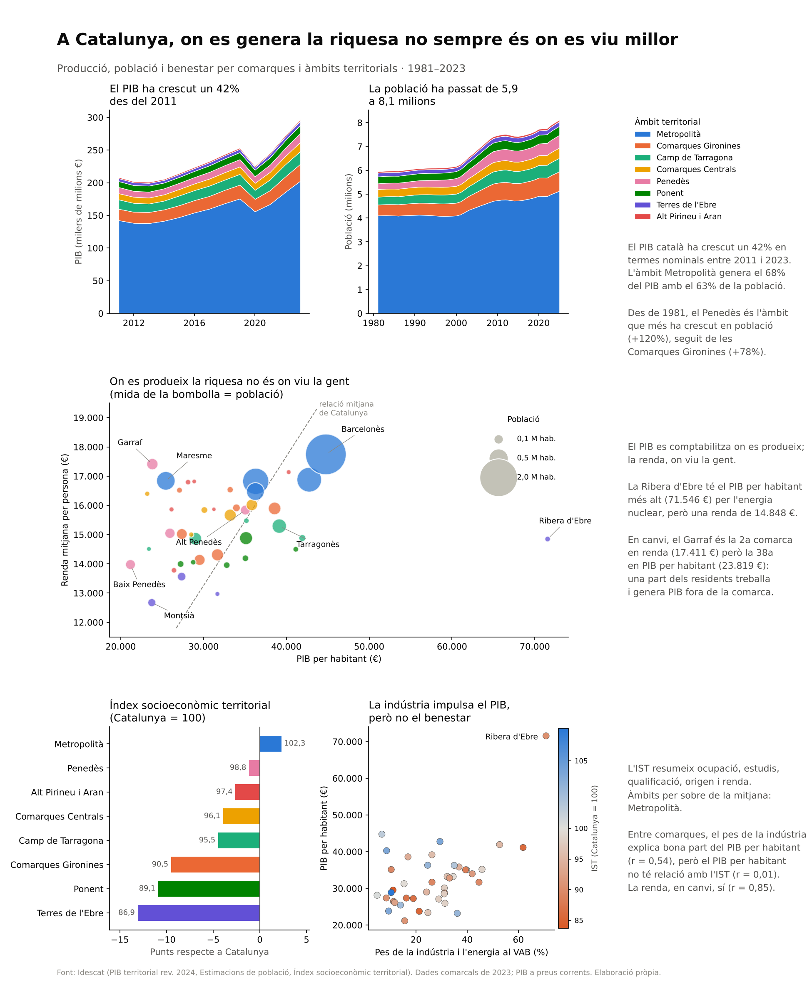

# Informe econòmic de Catalunya · dades de l'Idescat

On es genera la riquesa a Catalunya, on viu la gent i com hi viu. Aquest informe compara les **42 comarques i l'Aran** i els **8 àmbits territorials** amb dades oficials de l'[Idescat](https://www.idescat.cat).

És una adaptació a Catalunya del projecte *World Economic Report* de Maven Analytics, que fa la mateixa comparació entre països amb dades del Banc Mundial.



## Què hi trobaràs

| Versió | Per a què | Com obrir-la |
|---|---|---|
| [**Infografia**](python/) | Llegir les conclusions en una sola pàgina | Obre la imatge [PNG](python/output/informe_economic_catalunya.png) o el [PDF](python/output/informe_economic_catalunya.pdf) |
| [**Informe de Power BI**](powerbi/) | Explorar les dades per any, àmbit i comarca | Obre `powerbi/informe_economic.pbip` amb Power BI Desktop. Les instruccions són a [`powerbi/README.md`](powerbi/) |

## Principals conclusions (2023)

- **El PIB ha crescut un 42%** entre el 2011 i el 2023, en termes nominals. L'àmbit Metropolità genera el 68% del PIB i hi viu el 63% de la població.
- **El Penedès és l'àmbit que més ha crescut** en població des del 1981 (+120%).
- **On es produeix la riquesa no és on viu la gent.** La Ribera d'Ebre té el PIB per habitant més alt de Catalunya, per l'energia nuclear, però una renda per persona per sota de la mitjana. El Garraf és la segona comarca en renda i una de les últimes en PIB per habitant.
- **El PIB per habitant no explica el benestar.** Entre comarques, la correlació amb l'índex socioeconòmic territorial (IST) és pràcticament nul·la (r = 0,01). La renda, en canvi, hi està molt relacionada (r = 0,85).

## Actualitzar les dades

Les dades es descarreguen de l'API de l'Idescat i es poden tornar a generar amb Python 3.10 o posterior:

```bash
pip install -r requirements.txt
python src/extract.py   # descarrega les taules de l'Idescat a data/processed/
python src/model.py     # prepara les taules de l'informe de Power BI a data/model/
```

Després, a la infografia, executa el notebook [`python/informe_economic.ipynb`](python/informe_economic.ipynb). A l'informe de Power BI, fes clic a **Actualitza**.

`data/processed/qa_report.md` resumeix la revisió de les dades descarregades: valors buits, dades provisionals i si les comarques sumen el total de cada àmbit.

## Fitxers

```
python/   infografia (notebook i imatge final)
powerbi/  informe de Power BI
data/     dades descarregades i preparades
src/      descàrrega i preparació de les dades
config/   correspondència entre comarques i àmbits territorials
tests/    proves
```

## Fonts

Dades: **[Idescat](https://www.idescat.cat)**, Institut d'Estadística de Catalunya, a través de l'[API Taules v2](https://www.idescat.cat/dev/api/taules/): PIB territorial, estimacions de població i índex socioeconòmic territorial. Les dades no s'han modificat. Cartografia: © Instituto Geográfico Nacional (CC BY 4.0).

Aquest projecte no té cap relació ni aval de l'Idescat.
