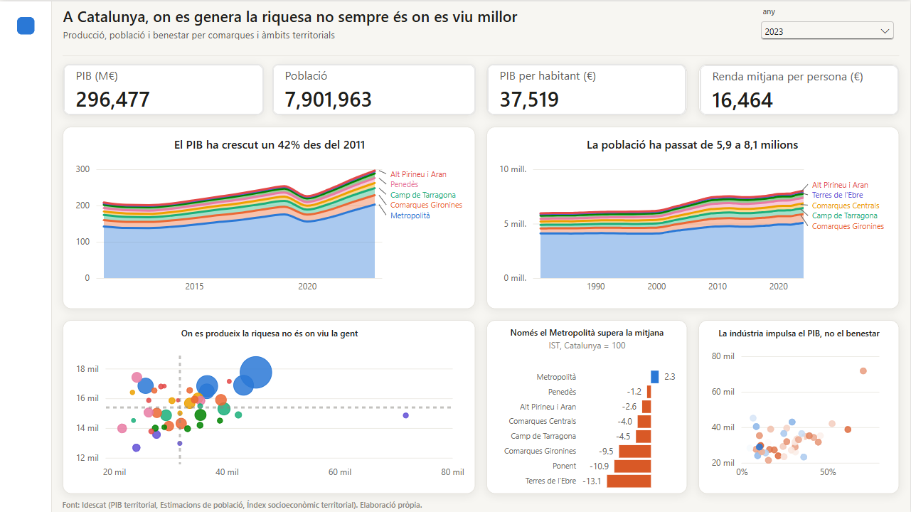
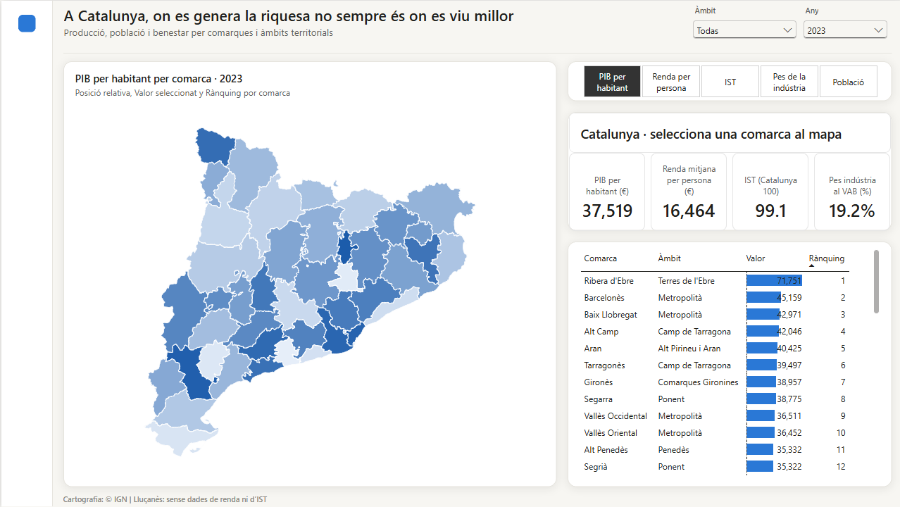

# Informe de Power BI

Informe interactiu sobre la producció, la població i el benestar de les comarques i els àmbits territorials de Catalunya, amb dades oficials de l'Idescat.

## Com obrir-lo

1. Instal·la [Power BI Desktop](https://powerbi.microsoft.com/desktop/) (gratuït, per a Windows).
2. Descarrega o clona aquest repositori i obre `powerbi/informe_economic.pbip`.
3. Si et demana credencials per a `raw.githubusercontent.com`, tria **Anònim**. Si et demana el nivell de privadesa, tria **Públic**.
4. Fes clic a **Actualitza** per carregar les últimes dades del repositori.

No cal cap compte de Microsoft ni cap llicència de pagament. Si en obrir-lo surt una finestra d'inici de sessió, la pots tancar.

## Pàgina 1 · Resum

Visió general de Catalunya per àmbits territorials.

- **Any** (a dalt a la dreta): tria l'any de les targetes i dels gràfics comarcals (2015–2023). Els dos gràfics d'evolució mostren sempre tota la sèrie.
- **Targetes:** PIB, població, PIB per habitant i renda per persona de Catalunya per a l'any triat.
- **El PIB ha crescut un 42% des del 2011** i **La població ha passat de 5,9 a 8,1 milions:** evolució de cada àmbit, apilat. L'etiqueta de la dreta indica quin àmbit és cada franja.
- **On es produeix la riquesa no és on viu la gent:** cada bombolla és una comarca, i la mida indica la població. Les línies discontínues marquen la mitjana i divideixen el gràfic en quatre quadrants:
  - **a la dreta i a baix:** comarques que produeixen molt però on els residents ingressen poc (per exemple, la Ribera d'Ebre);
  - **a l'esquerra i a dalt:** comarques residencials, on part dels residents treballen fora (per exemple, el Garraf o el Maresme).
- **Només el Metropolità supera la mitjana:** diferència de l'IST de cada àmbit respecte a Catalunya (= 100).
- **La indústria impulsa el PIB, no el benestar:** cada punt és una comarca. El color indica l'IST: blau per sobre de la mitjana i taronja per sota.

Passa el ratolí per sobre de qualsevol punt o barra per veure'n el detall. Fes-hi clic per filtrar la resta de la pàgina, i torna-hi a fer clic per treure el filtre.

## Pàgina 2 · Comarques

Detall de les 42 comarques i l'Aran.

1. **Tria un indicador** amb els botons de dalt a la dreta: PIB per habitant, renda per persona, IST, pes de la indústria o població. El mapa, la taula i el títol del mapa canvien.
2. **Llegeix el mapa:** com més fosc és el color, més amunt és la comarca en el rànquing de l'indicador triat. El color indica la **posició** i no el valor, perquè així es poden comparar els cinc indicadors amb la mateixa escala. Passa el ratolí per sobre d'una comarca per veure'n el valor i la posició.
3. **Fes clic en una comarca** del mapa o de la taula. La fitxa mostra el nom de la comarca, la seva posició en el rànquing i els seus quatre indicadors principals. Torna-hi a fer clic per tornar a veure Catalunya.
4. **Filtra per àmbit** amb el segmentador de dalt per veure només les comarques d'un àmbit.

La taula s'ordena per posició. Fes clic a la capçalera d'una columna per ordenar-la d'una altra manera.

## Indicadors

| Indicador | Què mesura | Font (Idescat) |
|---|---|---|
| PIB | Producte interior brut a preus corrents, en milions d'euros. Es comptabilitza on es produeix | PIB territorial (revisió 2024) |
| Població | Població a 1 de gener | Estimacions de població |
| PIB per habitant | PIB dividit per la població a 1 de gener | Calculat |
| Renda per persona | Renda mitjana per persona dels residents | Índex socioeconòmic territorial |
| IST | Índex socioeconòmic territorial (Catalunya = 100): ocupació, estudis, qualificació laboral, origen i renda | Índex socioeconòmic territorial |
| Pes de la indústria | Part del valor afegit brut que generen la indústria i l'energia | PIB territorial, VAB per sectors |

## Coses a tenir en compte

- **Anys:** el PIB arriba fins al 2023, i la renda i l'IST comencen el 2015. Per això l'any es pot triar entre el 2015 i el 2023.
- **PIB per habitant:** pot diferir lleugerament del valor que publica l'Idescat, perquè aquí es divideix per la població a 1 de gener i l'Idescat fa servir la població mitjana de l'any.
- **Àmbits:** les xifres d'un àmbit són la suma de les seves comarques. Respecte de les xifres oficials per àmbit, la diferència és inferior a l'1%, perquè alguns municipis pertanyen a un àmbit diferent del de la seva comarca. L'IST i la renda d'un àmbit són la mitjana de les seves comarques ponderada per població.
- **Lluçanès:** és comarca des del 2023 i encara no té dades de renda ni d'IST, per això surt en gris al mapa.

## Fonts

Dades: [Idescat](https://www.idescat.cat), API Taules v2. Cartografia: © Instituto Geográfico Nacional (CC BY 4.0). Aquest informe no té cap relació ni aval de l'Idescat.
