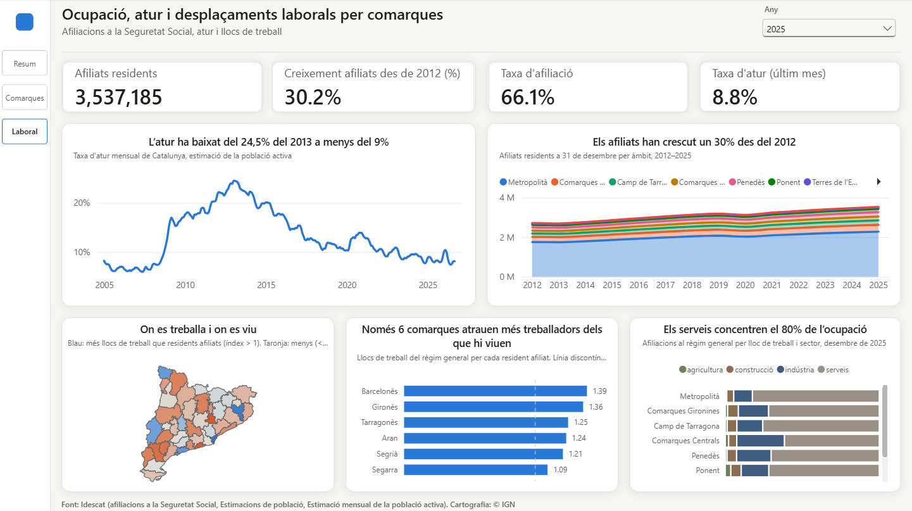

# Informe de Power BI

Informe interactiu sobre la producció, la població i la situació socioeconòmica de les comarques i els àmbits territorials de Catalunya, amb dades oficials de l'Idescat.

## Com obrir-lo

1. Instal·la [Power BI Desktop](https://powerbi.microsoft.com/desktop/) (gratuït, per a Windows).
2. Descarrega o clona aquest repositori i obre `powerbi/informe_economic.pbip`.
3. Si et demana credencials per a `raw.githubusercontent.com`, tria **Anònim**. Si et demana el nivell de privadesa, tria **Públic**.
4. Fes clic a **Actualitza** per carregar les últimes dades del repositori.

No cal cap compte de Microsoft ni cap llicència de pagament. Si en obrir-lo surt una finestra d'inici de sessió, la pots tancar.

## Pàgina 1 · Resum

Visió general de Catalunya per àmbits territorials.

- **Any** (a dalt a la dreta): tria l'any de les targetes i dels gràfics comarcals (2015–2023). Els dos gràfics d'evolució mostren sempre tota la sèrie.
- **Targetes:** PIB, població, PIB per habitant i renda per persona de Catalunya per a l'any triat.
- **El PIB ha crescut un 42% des del 2011** i **La població ha passat de 5,9 a 8,1 milions:** evolució de cada àmbit, apilat. L'etiqueta de la dreta indica quin àmbit és cada franja.
- **On es produeix la riquesa no és on viu la gent:** cada bombolla és una comarca, i la mida indica la població. Les línies discontínues marquen la mitjana i divideixen el gràfic en quatre quadrants:
  - **a la dreta i a baix:** comarques que produeixen molt però on els residents ingressen poc (per exemple, la Ribera d'Ebre);
  - **a l'esquerra i a dalt:** comarques residencials, on part dels residents treballen fora (per exemple, el Garraf o el Maresme).
- **Només el Metropolità supera la mitjana:** diferència de l'IST de cada àmbit respecte a Catalunya (= 100).
- **La indústria explica part del PIB, no la situació socioeconòmica:** cada punt és una comarca. El color indica l'IST: blau per sobre de la mitjana i taronja per sota.

Passa el ratolí per sobre de qualsevol punt o barra per veure'n el detall. Fes-hi clic per filtrar la resta de la pàgina, i torna-hi a fer clic per treure el filtre.

## Pàgina 2 · Comarques

Detall de les 42 comarques i l'Aran.

1. **Tria un indicador** amb els botons de dalt a la dreta: PIB per habitant, renda per persona, IST, pes de la indústria o població. El mapa, la taula i el títol del mapa canvien.
2. **Llegeix el mapa:** com més fosc és el color, més amunt és la comarca en el rànquing de l'indicador triat. El color indica la **posició** i no el valor, perquè així es poden comparar els cinc indicadors amb la mateixa escala. Passa el ratolí per sobre d'una comarca per veure'n el valor i la posició.
3. **Fes clic en una comarca** del mapa o de la taula. La fitxa mostra el nom de la comarca, la seva posició en el rànquing i els seus quatre indicadors principals. Torna-hi a fer clic per tornar a veure Catalunya.
4. **Filtra per àmbit** amb el segmentador de dalt per veure només les comarques d'un àmbit.

La taula s'ordena per posició. Fes clic a la capçalera d'una columna per ordenar-la d'una altra manera.

## Pàgina 3 · Laboral

Ocupació, atur i desplaçaments per feina.

- **Any** (a dalt a la dreta): tria l'any de les targetes, del mapa i dels rànquings (2020–2025). Les dades són a 31 de desembre. Els dos gràfics d'evolució mostren sempre tota la sèrie.
- **Targetes:** afiliats a la Seguretat Social residents a Catalunya, creixement des del 2012, taxa d'afiliació i taxa d'atur del darrer mes de l'any.
- **Evolució de l'atur:** taxa d'atur mensual de Catalunya des del 2005.
- **Evolució dels afiliats:** afiliats per àmbit de residència des del 2012.
- **On es treballa i on es viu:** cada comarca s'acoloreix segons el seu **índex d'atracció laboral**, que compara els llocs de treball de la comarca amb els seus residents que treballen:
  - **blau (més d'1):** la comarca té més llocs de treball que residents afiliats i rep treballadors d'altres comarques;
  - **gris (al voltant d'1):** els llocs de treball i els residents que treballen estan equilibrats;
  - **taronja (menys d'1):** una part dels residents treballen fora de la comarca. Per exemple, un índex de 0,46 vol dir que hi ha 46 llocs de treball per cada 100 residents afiliats.
- **Rànquing:** les comarques amb un índex d'atracció més gran que 1.
- **Sectors:** pes de l'agricultura, la indústria, la construcció i els serveis en els llocs de treball de cada àmbit.

## Indicadors

| Indicador | Què mesura | Font (Idescat) |
|---|---|---|
| PIB | Producte interior brut a preus corrents, en milions d'euros. Es comptabilitza on es produeix | PIB territorial (revisió 2024) |
| Població | Població a 1 de gener | Estimacions de població |
| PIB per habitant | PIB dividit per la població a 1 de juliol, com fa l'Idescat | Calculat |
| Renda per persona | Renda mitjana per persona dels residents | Índex socioeconòmic territorial |
| IST | Índex socioeconòmic territorial (Catalunya = 100): ocupació, estudis, qualificació laboral, origen i renda | Índex socioeconòmic territorial |
| Pes de la indústria | Part del valor afegit brut que generen la indústria i l'energia | PIB territorial, VAB per sectors |
| Afiliats residents | Persones afiliades a la Seguretat Social que viuen al territori, a 31 de desembre | Afiliats segons residència |
| Taxa d'afiliació | Afiliats residents dividits per la població de 16 a 64 anys | Calculat |
| Índex d'atracció laboral | Afiliacions al règim general en centres de treball de la comarca dividides per les dels seus residents | Afiliacions segons residència i segons lloc de treball |
| Taxa d'atur | Percentatge de la població activa que no té feina (estimació mensual, només per a Catalunya) | Estimació mensual de la població activa |

## Coses a tenir en compte

- **Anys:** el PIB arriba fins al 2023, i la renda i l'IST comencen el 2015. Per això l'any es pot triar entre el 2015 i el 2023.
- **PIB per habitant:** es divideix el PIB per la població a 1 de juliol, igual que l'Idescat, i per això coincideix amb el valor oficial. La població que es mostra a la resta de l'informe és la de l'1 de gener.
- **Àmbits:** 12 municipis pertanyen a un àmbit diferent del de la seva comarca: Castellcir, Castellterçol, Granera i Sant Quirze Safaja (Moianès) són de l'àmbit Metropolità, i els 8 municipis de l'Alta Segarra (Anoia) són de les Comarques Centrals. Per això, des del 2015 la població i els afiliats d'un àmbit són les xifres oficials de l'àmbit, i la suma de les comarques d'un àmbit pot no coincidir exactament amb el total. El PIB i el VAB d'un àmbit són la suma de les seves comarques, perquè l'Idescat no publica el PIB dels municipis petits; la diferència amb el PIB oficial per àmbit és inferior a l'1%. Els creixements des del 1981 i des del 2012 es calculen amb els límits de les comarques, perquè els dos anys siguin comparables. L'IST i la renda d'un àmbit són la mitjana de les seves comarques ponderada per població.
- **Mercat laboral:** l'índex d'atracció només inclou el règim general (assalariats), no els autònoms, i compta afiliacions, no persones. Les afiliacions s'assignen al municipi del compte de cotització de l'empresa, que no sempre és el lloc on es treballa; per això les comarques amb seus d'empreses, com el Barcelonès, poden sortir amb un índex més alt. Les dades per lloc de treball comencen el desembre del 2020.
- **Afiliats:** són els afiliats que viuen al territori. L'Idescat publica uns 120.000 afiliats més com a "no residents a Catalunya o altres", que no són de cap comarca i no es compten en el total de Catalunya.
- **Accessibilitat:** cada visual té un text alternatiu per a lectors de pantalla, l'ordre de tabulació va del títol als selectors, les targetes i els gràfics, i els colors dels àmbits tenen un contrast mínim de 3:1. Al Narrador de Windows o a NVDA, la tecla Tab recorre els visuals de cada pàgina.
- **Canvis de límits comarcals:** el 2015 es va crear el Moianès i el 2023 el Lluçanès; el 2023 Biosca i Torà van passar de la Segarra al Solsonès, i el 2025 Aiguafreda, del Vallès Oriental a Osona. Les sèries de les comarques afectades (Bages, Lluçanès, Moianès, Osona, Segarra, Solsonès i Vallès Oriental) canvien de cop aquells anys, i per això el creixement de població des del 1981 i el d'afiliats des del 2012 surten en blanc per a aquestes comarques.
- **Lluçanès:** és comarca des del 2023 i encara no té dades de renda ni d'IST, per això surt en gris al mapa.

## Fonts

Dades: [Idescat](https://www.idescat.cat), API Taules v2. Cartografia: © Instituto Geográfico Nacional (CC BY 4.0). Aquest informe no té cap relació ni aval de l'Idescat.
